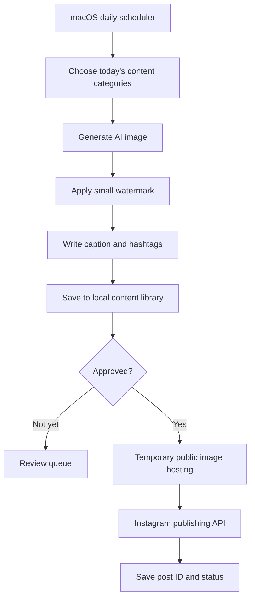

<div align="center">

# ✨ AI Content Engine

### Create. Brand. Schedule. Publish.

**A local-first AI content generation and social publishing toolkit built with Python.**

[](https://python.org)


**[Overview](#-overview) · [Features](#-planned-features) · [Workflow](#-workflow) · [Setup](#-getting-started) · [Roadmap](#-roadmap)**

</div>

---

## 🌿 Overview

**AI Content Engine** aims to automate the creative process from initial concept to published social post: generate distinctive AI images, apply subtle brand watermarks, create unique captions, organize content locally, and publish through authorized platform APIs.

The first preset focuses on **minimal product product photography** — lamps, bags, accessories and homewares on clean neutral backgrounds. The architecture is intended to grow beyond product and Instagram.

> [!IMPORTANT]
> **Project status:** The Mac automation source code and setup scripts are available in this repository. Offline demo and syntax checks have been performed on the original project; **live OpenAI, Cloudinary and Instagram integration has not been verified with your credentials**. Publishing starts disabled.

## ✨ Features

| Feature | What it does |
| :--- | :--- |
| 🎨 AI image creation | Produce high-quality, product-focused images with varied styles |
| 🧩 Content planning | Rotate subjects, silhouettes, colors and materials |
| 🏷️ Brand watermark | Add a small, tasteful corner logo |
| ✍️ AI captions | Create descriptions, calls to action and hashtags |
| 📂 Local library | Save images, captions, metadata and publishing history |
| 👀 Review mode | Keep publishing off until content is approved |
| 📅 Local scheduling | Run daily using macOS `launchd` |
| 📲 Instagram publishing | Use Meta's official API with quota checks and retries |
| 🔐 Secret management | Load tokens from a local, ignored `.env` file |

## 🔄 Workflow



**Local-first does not mean offline:** Python and the scheduler run on your Mac, but AI generation and Instagram publishing need internet access. Meta must retrieve each post image over a public HTTPS URL, so temporary media hosting is needed for API publishing.

## 🖼️ Creative direction

A consistent, premium catalogue look:

- **Product focus:** one clearly framed item, without busy staging
- **Neutral backgrounds:** ivory, beige, warm grey or off-white
- **Realistic presentation:** natural shadows and believable proportions
- **Light branding:** small logo along the lower edge
- **Variety:** lamps, accessories, homewares and other consumer products

AI concept renders should be labeled appropriately; don't present designs as manufactured inventory unless a supplier can make them.

## 🚀 Getting started

### Requirements

- macOS and Python **3.11+**
- **No OpenAI API key needed** when using the default local generator
- Optional [OpenAI API key](https://platform.openai.com/api-keys) if you choose the paid provider
- Instagram professional account with Meta publishing authorization
- Temporary public HTTPS media hosting for Instagram API uploads

### 1. Clone

```bash
git clone https://github.com/summiya/ai-content-engine.git
cd ai-content-engine
```

### 2. Prepare Python

```bash
python3 -m venv .venv
source .venv/bin/activate
```

### 3. Install and test

Run the installer (it creates a virtual environment, installs packages, copies `.env.example` to `.env`, and generates a free offline watermark demo):

```bash
chmod +x install_mac.sh enable_mac_schedule.sh disable_mac_schedule.sh
./install_mac.sh
```

For **free local images on an M3 Mac**, install [uv](https://docs.astral.sh/uv/getting-started/installation/) (`brew install uv` if you use Homebrew), then install MFLUX:

```bash
chmod +x install_local_ai.sh
./install_local_ai.sh
```

Set `IMAGE_PROVIDER=local`, `AI_CAPTIONS=false`, `DAILY_COUNT=1`, and `AUTO_PUBLISH=false` in `.env`. You do **not** need an OpenAI API key. The first image requires a sizeable model download.

```bash
.venv/bin/python content_engine.py doctor
.venv/bin/python content_engine.py daily
.venv/bin/python content_engine.py status
```

Check `output/YYYY-MM-DD/` for the generated image and `output/queue.json` for its caption and schedule. Local generation has no per-image OpenAI API charge; optional OpenAI generation incurs charges. To publish, configure your Meta professional account ID, access token, and Cloudinary URL, test access with `doctor`, and change `AUTO_PUBLISH=true` **only after verifying everything**.

To enable the local Mac scheduler (runs every 15 minutes while the Mac is awake and logged in):

```bash
./enable_mac_schedule.sh
```

To disable it:

```bash
./disable_mac_schedule.sh
```

See `content_engine.py` for the `demo`, `daily`, `publish`, `run`, `status`, and `doctor` commands. Uncertain publication outcomes must be checked manually to avoid duplicate posts.

## ⚙️ Example configuration (planned)

The keys below are supported by the included `content_engine.py` script. Use `.env.example` for the complete template.

```dotenv
IMAGE_PROVIDER=local
AI_CAPTIONS=false
LOCAL_IMAGE_WIDTH=768
LOCAL_IMAGE_HEIGHT=960
# OPENAI_API_KEY=optional_for_paid_openai_mode
INSTAGRAM_ACCESS_TOKEN=replace_with_meta_token
INSTAGRAM_USER_ID=replace_with_account_id

DAILY_COUNT=20
AUTO_PUBLISH=false
IMAGE_QUALITY=medium
TIMEZONE=UTC
```

> [!CAUTION]
> Never commit real keys or your `.env` file. Add `.env`, local generated media and virtual environments to `.gitignore`. Revoke any credentials accidentally pushed to GitHub.

## 📈 Content volume

The initial goal is **20 unique generated images per day**, or approximately **600 images per 30-day month**. Generation and publishing should be separate settings: you can create 20 images without publishing 20 posts. Actual Instagram API limits are account- and policy-dependent, so the publisher must query the current quota and handle rate limits.

## 🧭 Roadmap

- [x] Add runnable Python source and dependency file
- [x] Create configurable prompt and product-category templates
- [x] Build image generator and local content archive
- [x] Implement Pillow logo watermarking
- [x] Generate captions, CTAs and hashtags
- [x] Keep publishing disabled by default
- [x] Implement Cloudinary image hosting + Meta API publishing path
- [x] Track post IDs and uncertain publish status in local queue
- [x] Set up macOS `launchd` scheduling
- [ ] Test local model generation on the actual M3 16GB Mac
- [ ] Complete real-account end-to-end integration testing
- [ ] Add automated tests, screenshots and troubleshooting
- [ ] Explore other social platforms and content categories

## 🛡️ Safety & reliability

Use official APIs, not password automation. Keep secrets off GitHub, turn on auto-publishing only after a successful manual test, and check platform quotas. The Mac must be awake and online when jobs run. Generated product visuals should be reviewed for accuracy and commercial suitability.

## 🤝 Contributing

Ideas and feedback are welcome. Contribution guidelines and test workflows will be added alongside the initial implementation.

## 📄 License

No license has been chosen. Until a license file is added, standard copyright restrictions apply.

---

<div align="center">

**An engine for ideas worth sharing.** ✨

<sub>Built for creativity • Designed for control • Made to scale</sub>

</div>

## 🆓 Free local generation (Apple Silicon)

The default provider uses **FLUX.2 Klein 4B** via **MFLUX**, with 4-bit quantization, its small text encoder, low-RAM mode, and 768×960 starting resolution. The model's Apache 2.0 license permits commercial use. Local caption templates also cost nothing. No paid OpenAI API is required unless you set `IMAGE_PROVIDER=openai` or `AI_CAPTIONS=true`.

Generate one test with `.venv/bin/python content_engine.py daily`, review `output/`, then increase `DAILY_COUNT` gradually. Speed and output quality on your specific Mac have not been tested. Your Mac must remain awake; initial model download and Instagram publishing require internet. Meta publishing still requires a public image URL (the project uses optional Cloudinary).
