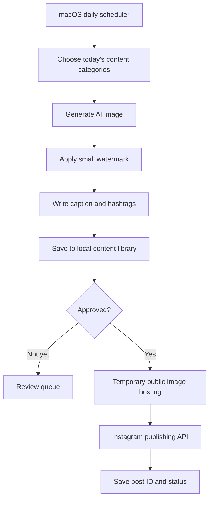

<div align="center">

# ✨ AI Content Engine

### Create. Brand. Schedule. Publish.

**A local-first AI content generation and social publishing toolkit built with Python.**

[](https://python.org)


**[Overview](#-overview) · [Features](#-planned-features) · [Workflow](#-workflow) · [Setup](#-getting-started) · [Roadmap](#-roadmap)**

</div>

---

## 🌿 Overview

**AI Content Engine** aims to automate the creative process from initial concept to published social post: generate distinctive AI images, apply subtle brand watermarks, create unique captions, organize content locally, and publish through authorized platform APIs.

The first preset focuses on **minimal furniture product photography** — sofas, beds, chairs and tables on clean neutral backgrounds. The architecture is intended to grow beyond furniture and Instagram.

> [!IMPORTANT]
> **Project status:** This repository currently contains documentation only. The Python application, dependencies and end-to-end publishing integration have not yet been committed. The capabilities below describe the project plan, not implemented features.

## ✨ Planned features

| Feature | What it does |
| :--- | :--- |
| 🎨 AI image creation | Produce high-quality, product-focused images with varied styles |
| 🧩 Content planning | Rotate subjects, silhouettes, colors and materials |
| 🏷️ Brand watermark | Add a small, tasteful corner logo |
| ✍️ AI captions | Create descriptions, calls to action and hashtags |
| 📂 Local library | Save images, captions, metadata and publishing history |
| 👀 Review mode | Keep publishing off until content is approved |
| 📅 Local scheduling | Run daily using macOS `launchd` |
| 📲 Instagram publishing | Use Meta's official API with quota checks and retries |
| 🔐 Secret management | Load tokens from a local, ignored `.env` file |

## 🔄 Workflow



**Local-first does not mean offline:** Python and the scheduler run on your Mac, but AI generation and Instagram publishing need internet access. Meta must retrieve each post image over a public HTTPS URL, so temporary media hosting is needed for API publishing.

## 🖼️ Creative direction

A consistent, premium catalogue look:

- **Product focus:** one clearly framed item, without busy staging
- **Neutral backgrounds:** ivory, beige, warm grey or off-white
- **Realistic presentation:** natural shadows and believable proportions
- **Light branding:** small logo along the lower edge
- **Variety:** beds, sofas, side tables, accent chairs, coffee tables, consoles and ottomans

AI concept renders should be labeled appropriately; don't present designs as manufactured inventory unless a supplier can make them.

## 🚀 Getting started

### Requirements

- macOS and Python **3.11+**
- [OpenAI API key](https://platform.openai.com/api-keys)
- Instagram professional account with Meta publishing authorization
- Temporary public HTTPS media hosting for Instagram API uploads

### 1. Clone

```bash
git clone https://github.com/summiya/ai-content-engine.git
cd ai-content-engine
```

### 2. Prepare Python

```bash
python3 -m venv .venv
source .venv/bin/activate
```

### 3. Install and test

The application files and dependency manifest are **not in this repository yet**. Once added, follow the installation instructions shipped with the code, create a local `.env`, generate **one sample** with publishing disabled, and verify the output before switching on automatic posts.

## ⚙️ Example configuration (planned)

The keys below illustrate the intended setup; they aren't a verified implementation schema yet.

```dotenv
OPENAI_API_KEY=replace_with_your_key
INSTAGRAM_ACCESS_TOKEN=replace_with_meta_token
INSTAGRAM_USER_ID=replace_with_account_id

DAILY_COUNT=20
AUTO_PUBLISH=false
IMAGE_QUALITY=medium
TIMEZONE=Asia/Dubai
```

> [!CAUTION]
> Never commit real keys or your `.env` file. Add `.env`, local generated media and virtual environments to `.gitignore`. Revoke any credentials accidentally pushed to GitHub.

## 📈 Content volume

The initial goal is **20 unique generated images per day**, or approximately **600 images per 30-day month**. Generation and publishing should be separate settings: you can create 20 images without publishing 20 posts. Actual Instagram API limits are account- and policy-dependent, so the publisher must query the current quota and handle rate limits.

## 🧭 Roadmap

- [ ] Add runnable Python source and dependency file
- [ ] Create configurable prompt and product-category templates
- [ ] Build image generator and local content archive
- [ ] Implement Pillow logo watermarking
- [ ] Generate captions, CTAs and hashtags
- [ ] Add review-first publishing queue
- [ ] Implement temporary image hosting + Meta API publishing
- [ ] Track publish IDs, errors, retries and account quotas
- [ ] Set up macOS `launchd` scheduling
- [ ] Add tests, screenshots and troubleshooting
- [ ] Explore other social platforms and content categories

## 🛡️ Safety & reliability

Use official APIs, not password automation. Keep secrets off GitHub, turn on auto-publishing only after a successful manual test, and check platform quotas. The Mac must be awake and online when jobs run. Generated product visuals should be reviewed for accuracy and commercial suitability.

## 🤝 Contributing

Ideas and feedback are welcome. Contribution guidelines and test workflows will be added alongside the initial implementation.

## 📄 License

No license has been chosen. Until a license file is added, standard copyright restrictions apply.

---

<div align="center">

**An engine for ideas worth sharing.** ✨

<sub>Built for creativity • Designed for control • Made to scale</sub>

</div>
